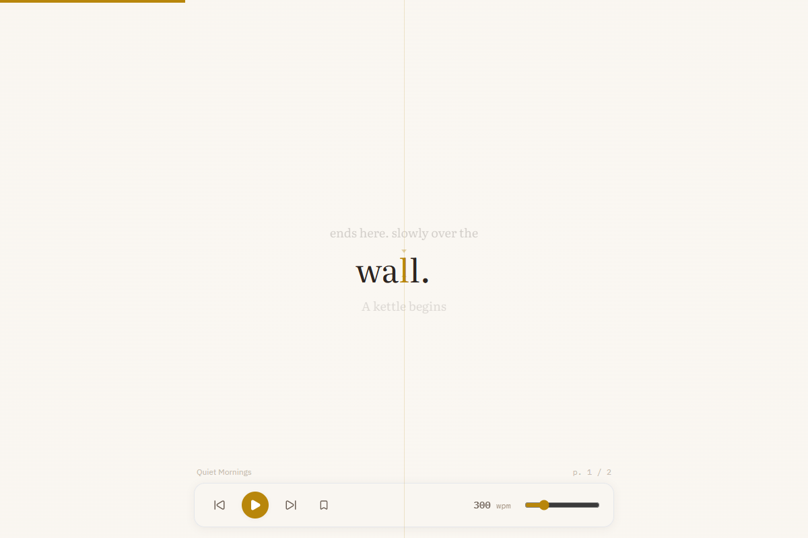
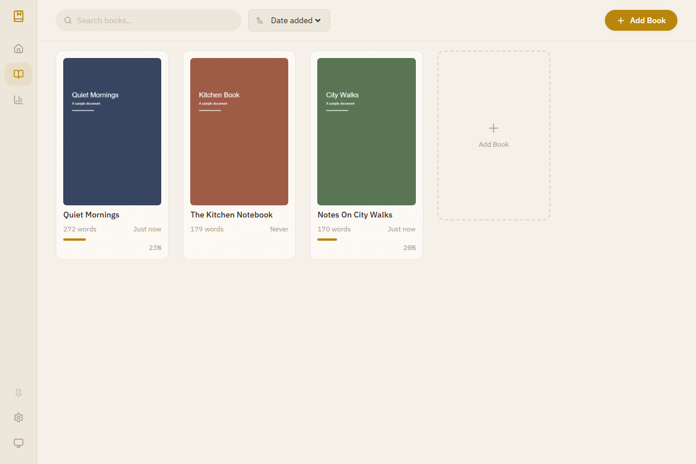
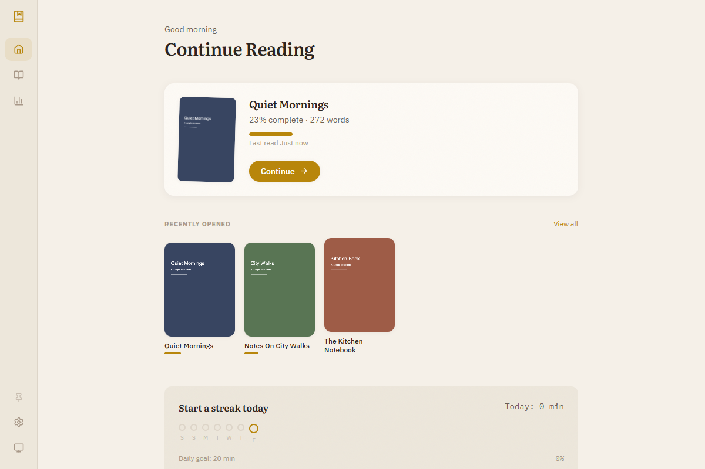

<p align="center">
  
</p>

<h1 align="center">FlowReader</h1>

<p align="center">
  A desktop speed reader that shows your PDF books one word at a time, at a fixed point on screen.
</p>

<p align="center">
  <a href="LICENSE"></a>
  <a href="https://github.com/MehmetAliAtik/flowreader/releases/latest"></a>
  
</p>

<p align="center">
  <a href="#download">Download</a> ·
  <a href="#features">Features</a> ·
  <a href="#keyboard-shortcuts">Shortcuts</a> ·
  <a href="#development">Development</a> ·
  <a href="#privacy">Privacy</a> ·
  <a href="#türkçe">Türkçe</a>
</p>

FlowReader is built around RSVP (Rapid Serial Visual Presentation): instead of moving your eyes across a page, you keep them in one place while the words come to you.



| Library | Home |
| --- | --- |
|  |  |

<sub>The screenshots show the app's interface with sample documents made for this purpose.</sub>

## Download

Windows (x64) builds are on the [Releases page](https://github.com/MehmetAliAtik/flowreader/releases/latest):

- **FlowReader.Setup.x.y.z.exe**: installer.
- **FlowReader-x.y.z-win-x64-portable.zip**: no installation needed. Extract it and run `FlowReader.exe`.

The builds are not code-signed, so Windows SmartScreen may warn about an unknown publisher. If you trust the download, choose **More info**, then **Run anyway**.

## Features

**Reading**

- One to three words per flash, with the highlighted focus letter of the first word held on a fixed center line.
- Speed setting from 100 to 1000 wpm, in steps of 25.
- Smart pausing: longer pauses after punctuation and on words of eight or more characters.
- Optional bold-prefix emphasis, which bolds the first letters of each word.
- Optional context words above and below the current word.
- Clickable progress bar and fullscreen mode.

**Library**

- Import PDF files; the text is extracted and the first page becomes the cover.
- Lines repeated across most pages (such as running headers) are removed, and words hyphenated across line breaks are rejoined.
- Search by title; sort by date added, last read, title or progress.
- Rename, reset progress or delete from each book's menu.

**Bookmarks and progress**

- Bookmarks with optional notes, per book.
- Your position is saved when you leave the reader, and you can continue, jump to a bookmark or start over.
- Reading stats (books finished, words read, time, average speed, last seven days, recent sessions), streaks and a daily goal.

**Appearance**

- Light, dark and system themes, five accent colors, five reading fonts and an adjustable font size.

## Keyboard shortcuts

| Key | Action |
| --- | --- |
| `Space` | Play / pause |
| `Left` / `Right` | Skip back / forward 10 words |
| `Up` / `Down` | Speed up / slow down by 25 wpm |
| `B` | Pause and add a bookmark |
| `Ctrl` + `B` | Show / hide the bookmarks panel |
| `F` | Toggle fullscreen |
| `Esc` | Pause and leave the reader |
| `Ctrl` + `,` | Open / close settings |

`Ctrl` + `,` works anywhere in the app; the other shortcuts apply to the reader.

## Known limitations

- PDF is the only supported format, and there is no OCR: scanned pages without a text layer yield no words.
- Single-page PDFs currently import with no text.
- Drag and drop import does not currently work; use the **Add Book** or **Import Book** button.
- With two or three words per flash, the speed setting counts flashes per minute, so the actual word rate is higher.

## Privacy

- **Your files and reading data stay on your computer.** An imported PDF is copied into the app's user-data folder (under `%APPDATA%` on Windows). Extracted text, covers, progress, bookmarks, notes, reading sessions and settings are stored there in a local IndexedDB database.
- **No accounts, analytics or telemetry** are built into FlowReader.
- **Fonts come from Google Fonts.** The app requests its fonts from `fonts.googleapis.com` (see [`src/styles/fonts.css`](src/styles/fonts.css)), so Google receives the usual web request information, such as your IP address.
- **Deleting a book** removes it and its reading data from the library, but currently leaves the copied PDF in the `books` folder inside the user-data folder.

These statements describe FlowReader's own source code. The network behaviour of the underlying Electron and Chromium runtime has not been audited.

## Development

Requires [Node.js](https://nodejs.org/) 22.12 or newer.

```bash
git clone https://github.com/MehmetAliAtik/flowreader.git
cd flowreader
npm install
npm run dev        # starts Vite and opens the Electron window
npm run build      # type-check and build the renderer and Electron code
npm run package    # build and create an installer in release/
```

### Tech stack

Electron, React, TypeScript, Vite, Tailwind CSS, Zustand, Dexie (IndexedDB), pdf.js, Framer Motion and Lucide icons.

### Project structure

```text
electron/          Main process, preload bridge and file handlers
src/
  pages/           Home, Library, Reader and Stats views
  components/      UI components
  hooks/           RSVP playback, PDF parsing, import, keyboard handling
  stores/          Zustand stores
  db/              Dexie database schema
  utils/           Text processing, pauses, streaks and measurement
  styles/          Global styles and font imports
build/             Application icons
electron-builder.yml
```

## Contributing

Bug reports and pull requests are welcome. See [CONTRIBUTING.md](CONTRIBUTING.md).

## License

FlowReader is released under the [MIT License](LICENSE), © 2026 Mehmet Ali Atik.

It includes third-party software under other licenses; see [THIRD-PARTY-NOTICES.md](THIRD-PARTY-NOTICES.md).

## Türkçe

FlowReader, PDF kitaplarınızı ekranda sabit bir noktada kelime kelime gösteren bir masaüstü hızlı okuma uygulamasıdır (RSVP yöntemi).

- **İndirme:** Windows (x64) kurulum dosyası ve taşınabilir sürüm [Releases sayfasında](https://github.com/MehmetAliAtik/flowreader/releases/latest). Dosyalar kod imzalı olmadığı için Windows SmartScreen uyarı gösterebilir.
- **Özellikler:** ayarlanabilir hız, akıllı duraklama, kelime başlarını kalın gösterme seçeneği, yer imleri ve notlar, okuma istatistikleri ve günlük hedef, açık ve koyu tema.
- **Sınırlamalar:** yalnızca PDF desteklenir, OCR yoktur. Tek sayfalık PDF'lerden şu anda metin alınamıyor ve sürükle-bırak ile içe aktarma çalışmıyor.
- **Gizlilik:** PDF'leriniz ve okuma verileriniz bilgisayarınızda kalır; hesap, analitik veya telemetri yoktur. Yazı tipleri Google Fonts'tan istenir. Bir kitabı silmek, uygulamanın veri klasörüne kopyalanan PDF dosyasını silmez.
- **Lisans:** [MIT](LICENSE). Üçüncü taraf bildirimleri: [THIRD-PARTY-NOTICES.md](THIRD-PARTY-NOTICES.md).

Uygulamanın arayüzü İngilizcedir.
